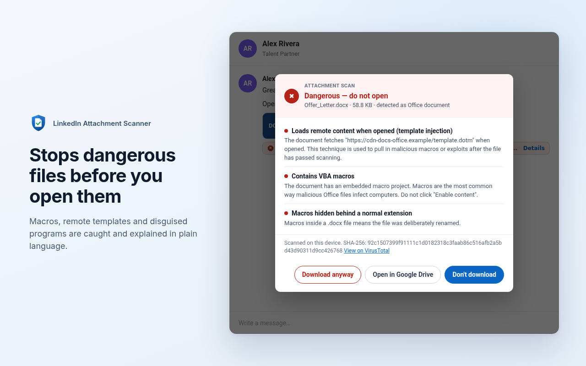
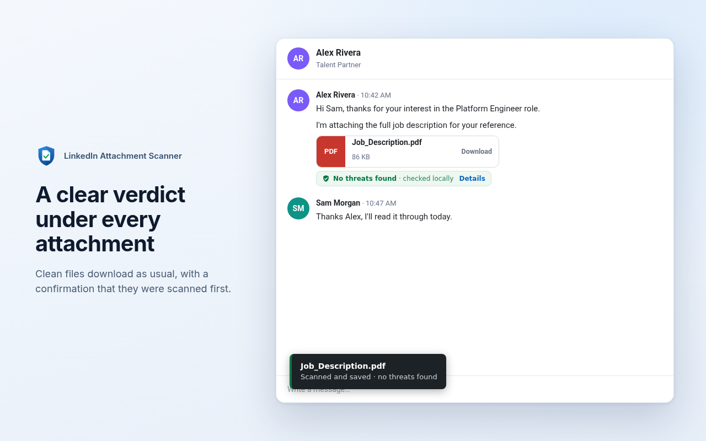
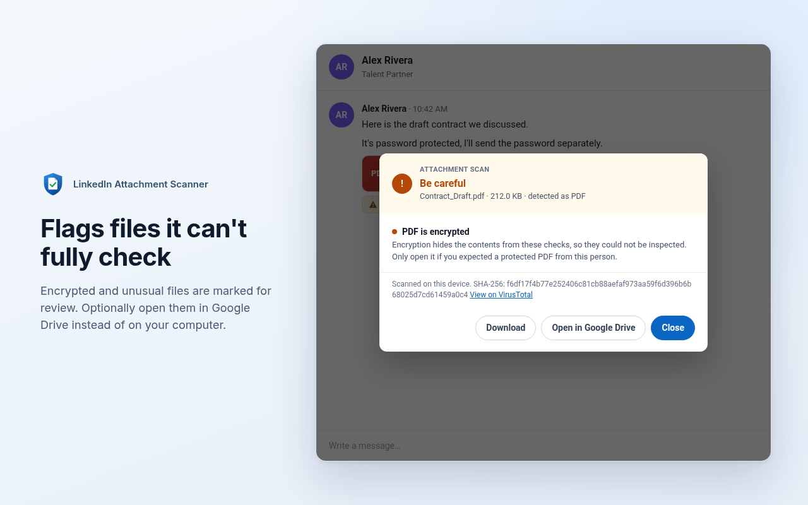
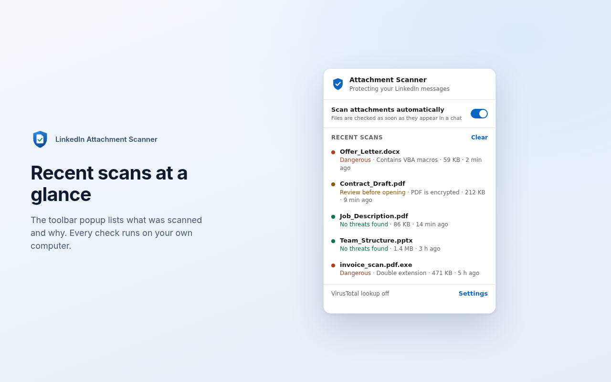

# LinkedIn Attachment Scanner (Firefox)

[](https://github.com/ortizjeronimo/linkedin-attachment-scanner/actions/workflows/ci.yml)
[](https://github.com/ortizjeronimo/linkedin-attachment-scanner/actions/workflows/security.yml)
[](https://github.com/ortizjeronimo/linkedin-attachment-scanner/releases/latest)
[](LICENSE)
[](https://addons.mozilla.org/en-US/firefox/addon/linkedin-attachment-scanner/)
[](https://addons.mozilla.org/en-US/firefox/addon/linkedin-attachment-scanner/)

**[Install from Firefox Add-ons](https://addons.mozilla.org/en-US/firefox/addon/linkedin-attachment-scanner/)** (Firefox 140 or newer)

Checks files sent to you in LinkedIn messages **before** they reach your Downloads folder.

## Screenshots

| | |
|---|---|
|  |  |
|  |  |

The extension's status line, dialogs and popup are shown as they really render. The conversation around them is a neutral stand-in with invented names, not a capture of LinkedIn.

## What it does

- **In chats:** a status line under each attachment shows the result: *No threats found*, *Review before opening*, or *Dangerous file*. Clean files download with one click as usual; anything else opens a details dialog first. Attachments LinkedIn shows as plain links are scanned as soon as they appear. Its current download-button cards are scanned when you click **Download** or **Scan now**, because LinkedIn only reveals the file at that point.
- **Toolbar popup:** lists recent scans and has an on/off switch for automatic scanning.
- **Safety net:** any other download coming from linkedin.com or licdn.com is paused and scanned. Dangerous files are cancelled and explained in a new tab. If a small file finished before the scan, you're offered to delete it.
- **Open in Google Drive (optional):** view an attachment in Google's online viewer instead of opening it on your computer. See [setup](#open-in-google-drive) below.
- **Privacy:** every check runs locally. With a VirusTotal key set, only the file's SHA-256 fingerprint is sent, never the file. A file is uploaded to Google Drive only when you click **Open in Google Drive** for it. Firefox asks for your permission before either feature is switched on. Details are in the [privacy policy](PRIVACY.md).

## What it detects

| Category | Checks |
|---|---|
| Office (docx/xlsx/pptx) | VBA macros, macros hidden in a non-macro extension, ActiveX, embedded OLE objects, remote template injection, links to network shares |
| Legacy Office (doc/xls/ppt) | VBA macros, Excel 4.0 macros, Equation Editor exploits, packaged objects, password protection |
| PDF | JavaScript (including hex-obfuscated names and compressed object streams), Launch actions, embedded files, auto-run actions, XFA/Flash, form submission, list of link domains |
| RTF | Embedded objects, auto-updating objects, Equation Editor references |
| Disguises | Real executables or shortcuts named as documents, double extensions (`cv.pdf.exe`), right-to-left override tricks, padded filenames, type/extension mismatch |
| Archives | Password protection, executables inside, nested archives, one level of nested Office files. RAR/7z are flagged as not inspectable. |
| HTML/SVG | Scripts, HTML smuggling, password fields, forms posting elsewhere |

## Install

Install it from [Firefox Add-ons](https://addons.mozilla.org/en-US/firefox/addon/linkedin-attachment-scanner/). Updates arrive automatically.

### From source (for development)

1. Clone or download this repository.
2. Open `about:debugging#/runtime/this-firefox` in Firefox 140 or newer.
3. Click **Load Temporary Add-on…** and pick `src/manifest.json`.
4. Open LinkedIn messaging and click an attachment.

Temporary add-ons are removed when Firefox restarts. For a permanent install, use the Firefox Add-ons version above.

Click the toolbar icon to open settings (VirusTotal key, safety-net options).

## Open in Google Drive

This is off until you give the extension your own Google OAuth client ID (free, about ten minutes):

1. In the [Google Cloud console](https://console.cloud.google.com/), create a project and enable the **Google Drive API**.
2. Configure the OAuth consent screen and add the scope `https://www.googleapis.com/auth/drive.file`. While the app is in "Testing", add your own Google account as a test user.
3. Create an **OAuth client ID** of type **Web application**. Under **Authorised redirect URIs**, add the address shown in the extension's settings (it looks like `http://127.0.0.1/mozoauth2/…`).
4. Paste the client ID into the extension's settings and save.

Scan results then show an **Open in Google Drive** button. The first use opens a Google sign-in window. The file is uploaded to your Drive (it stays there until you delete it) and opened in Google's viewer in a new tab; nothing is saved to your Downloads folder. The `drive.file` scope only lets the extension see files it uploaded itself.

## Development

The extension is plain JavaScript with no build step. Everything Firefox loads lives in `src/`.

```
src/
  manifest.json
  background.js   download safety net, scan orchestration, VirusTotal lookup
  analyzer.js     file format checks (runs in the background page)
  content.js      LinkedIn page integration
  render.js       result rendering shared by the page dialog and warning tab
  popup.html/js   toolbar popup
  options.html/js settings page
  warning.html/js tab shown when a download is blocked
  icons/
test/
  analyzer.test.js  crafted files and the verdict each must get
```

With Node.js installed, [web-ext](https://extensionworkshop.com/documentation/develop/getting-started-with-web-ext/) covers the usual tasks:

```
npx web-ext run   --source-dir src   # launch Firefox with the extension loaded, reloads on change
npx web-ext lint  --source-dir src   # validate the manifest and code
npx web-ext build --source-dir src   # package a zip into web-ext-artifacts/
```

The analyzer has a test file of crafted documents, each with the verdict it must get:

```
node test/analyzer.test.js
node test/background.test.js
```

## CI/CD

Three GitHub Actions workflows live in `.github/workflows/`:

| Workflow | Runs on | What it does |
|---|---|---|
| `ci.yml` | every push and pull request | Syntax check, manifest validation, `web-ext lint` (warnings fail the build), analyzer tests on Node 20, 22 and 24, then packages the extension and uploads it with its SHA-256 |
| `security.yml` | every push and pull request, and weekly | Gitleaks over the full git history, Trivy (dependencies, secrets, misconfigurations, licences; fails on HIGH or CRITICAL), CodeQL static analysis. Trivy and CodeQL results appear under the repository's **Security → Code scanning** tab |
| `release.yml` | a tag like `v0.2.0` | Checks the tag matches the manifest version, reruns CI, then publishes a GitHub release with the package, a CycloneDX SBOM, `SHA256SUMS`, a keyless cosign signature, and signed build-provenance and SBOM attestations |

To cut a release, run `scripts/set-version.sh <version>` (it updates `src/manifest.json` and `sbom.cdx.json` together; CI fails if they differ), merge that through a pull request, then `git tag v<version> && git push origin v<version>`. Anyone can verify a downloaded package with `gh attestation verify <file>.zip --repo ortizjeronimo/linkedin-attachment-scanner`, or with `cosign verify-blob` as shown in [SECURITY.md](SECURITY.md).

Submitting to addons.mozilla.org is opt-in: set the repository variable `AMO_SIGN=true` and put the secrets `AMO_JWT_ISSUER` and `AMO_JWT_SECRET` in a `mozilla` environment (with required reviewers and a `v*` tag rule), and each release is also uploaded, after approval, to the add-on's listing for Mozilla to sign and publish. The first version has to be submitted by hand on the site.

Actions are pinned to full commit hashes, with the version in a trailing comment. Dependabot (`.github/dependabot.yml`) opens weekly pull requests that move both the hash and the comment.

## Limitations

- LinkedIn changes its page markup often. If the status line stops appearing, the download safety net still catches the file; adjust `isAttachmentLink()` and `BUTTON_SEL` in `content.js`.
- LinkedIn's current attachment card is a button with no file address, so those attachments are scanned when you click **Download** or **Scan now** instead of automatically. To scan one, the extension lets LinkedIn start the download, cancels it, and scans its own copy.
- This is a heuristic scanner, not antivirus. A file with no red flags can still be malicious, especially with VirusTotal off or for a brand-new file.
- Contents of RAR and 7z archives and encrypted files can't be inspected.
- A file opened with **Open in Google Drive** is stored in your Drive. If you run Google Drive for desktop with syncing on, it can be copied back to your computer, so delete files you don't trust from Drive once you've looked at them.

## Changelog

Release notes for every version are in [CHANGELOG.md](CHANGELOG.md).

## Contributing

See [CONTRIBUTING.md](CONTRIBUTING.md) for setup, the checks to run before a pull request, and how the SBOM (`sbom.cdx.json`) is generated.

## License

[MIT](LICENSE)
